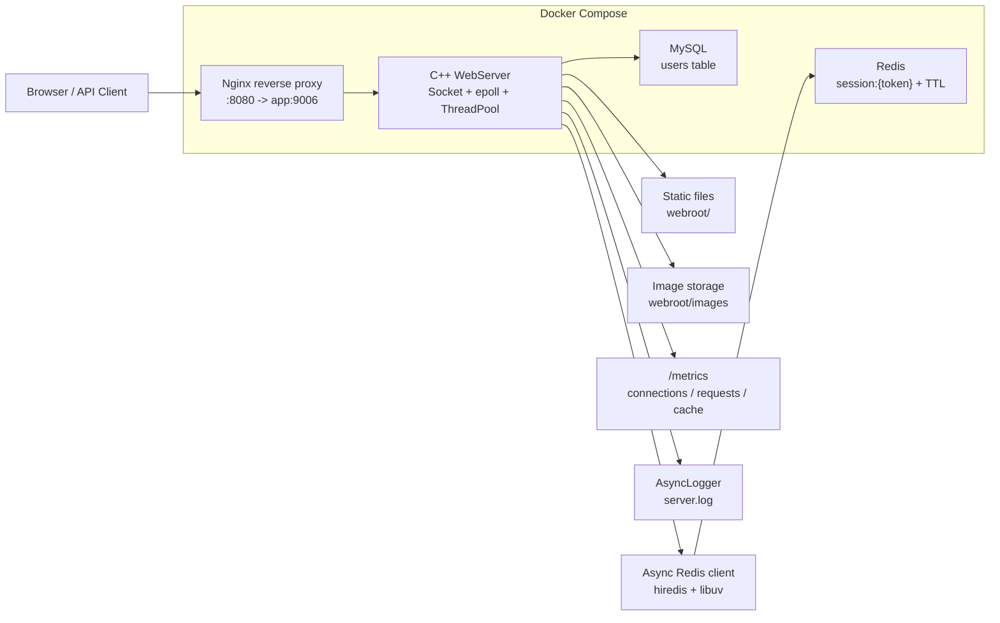
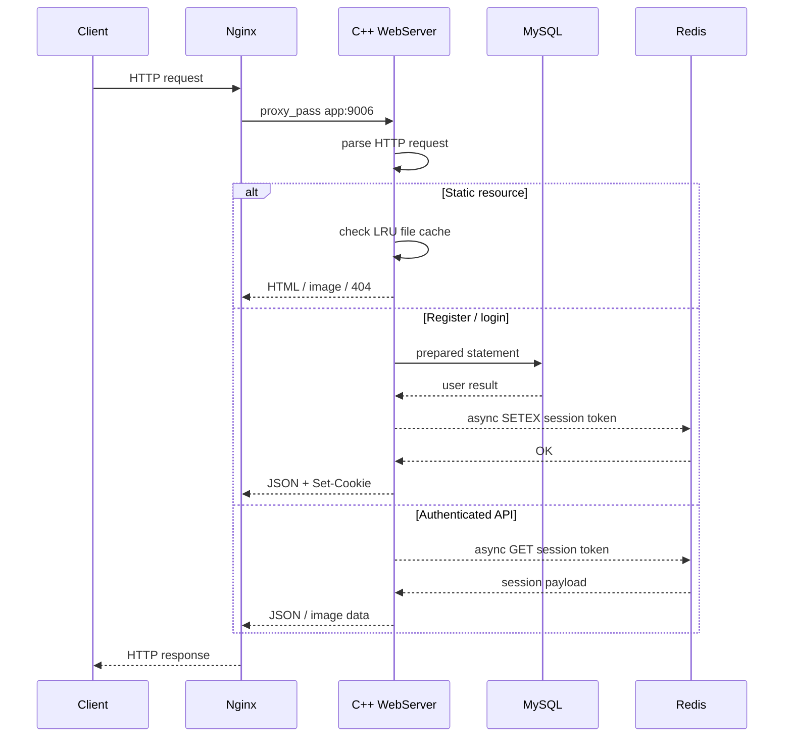
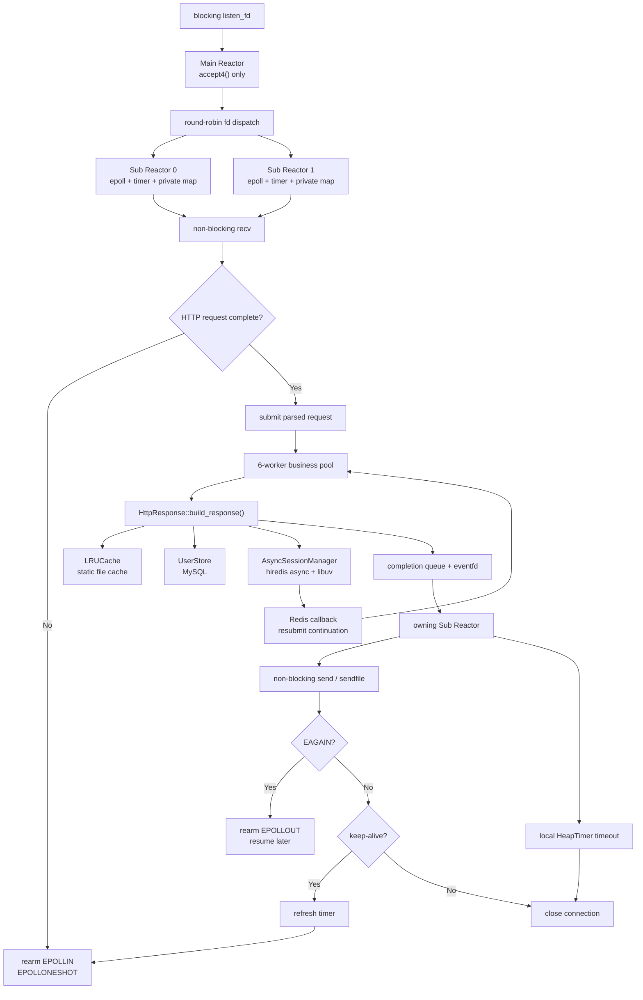

# MyWebServer Architecture And Benchmark

## Overall Architecture



### Request Flow



## Internal Concurrency Model



### Interview Explanation

The Main Reactor only accepts sockets and distributes them round-robin to two Sub
Reactors. Each Sub owns one epoll instance, one timer and one private connection map,
so connection lifecycle operations do not require a global map lock. Sub Reactors
perform non-blocking socket IO and submit complete requests to the six-worker business
pool. Workers never access connection objects directly; they return response tasks to
the owning Sub through a queue and `eventfd` wakeup.

`EPOLLONESHOT` permits only one in-flight request per connection. Partial writes and
`sendfile` operations resume through `EPOLLOUT` instead of blocking a Sub Reactor.
Both epoll events and worker completions carry a connection generation, preventing a
late event from acting on a reused numeric fd.

The timer uses a min-heap plus lazy deletion. An incomplete or keep-alive connection
uses the configurable idle timeout. Once a complete request is submitted, the timer
is changed to the business timeout. Expiration closes the connection and sets a
shared cancellation token; worker continuations stop, and upload/register/delete
transactions check that token before commit. MySQL calls already executing inside
the client library are bounded by their own I/O timeout because cooperative
cancellation cannot interrupt an arbitrary blocking C API call safely.

Every overload-sensitive buffer is bounded: accepted connections per Sub Reactor,
pending fd dispatch, worker tasks, response completions, Redis commands and pipeline
depth, log records, and process-local caches. Queue-full paths reject early and are
visible through `/metrics` instead of consuming memory without limit.

## Benchmark Guide

### 1. Start The Service

Docker Compose mode:

```bash
cd MyWebServer
docker compose up -d --build
curl http://127.0.0.1:8080/
curl http://127.0.0.1:8080/metrics
```

Local mode:

```bash
cd MyWebServer
cmake -S . -B build -DCMAKE_BUILD_TYPE=Release
cmake --build build
./build/my_web_server 9006 ./webroot 6
curl http://127.0.0.1:9006/
curl http://127.0.0.1:9006/metrics
```

### 2. Use wrk

Install on Ubuntu / WSL:

```bash
sudo apt update
sudo apt install -y wrk
```

Test static homepage through Nginx:

```bash
wrk -t4 -c100 -d30s http://127.0.0.1:8080/
```

Test backend directly:

```bash
wrk -t4 -c100 -d30s http://127.0.0.1:9006/
```

Test metrics endpoint:

```bash
wrk -t4 -c100 -d30s http://127.0.0.1:8080/metrics
```

Recommended test matrix:

```bash
wrk -t2 -c50  -d30s http://127.0.0.1:8080/
wrk -t4 -c100 -d30s http://127.0.0.1:8080/
wrk -t8 -c300 -d30s http://127.0.0.1:8080/
wrk -t8 -c500 -d30s http://127.0.0.1:8080/
```

### 3. Use ab If wrk Is Not Available

```bash
sudo apt install -y apache2-utils
ab -n 10000 -c 100 http://127.0.0.1:8080/
```

Meaning:

- `-n 10000`: total requests
- `-c 100`: concurrent clients

### 4. Record These Numbers

For `wrk`, record:

- `Requests/sec`: QPS
- `Latency`: average latency
- `Latency Distribution`: P50 / P90 / P99 if using a Lua script or wrk2
- `Socket errors`: connection/read/write/timeout errors

For `ab`, record:

- `Requests per second`
- `Time per request`
- `Transfer rate`
- `Failed requests`

Also query the server metrics:

```bash
curl http://127.0.0.1:8080/metrics
```

### 5. Resume Bullet With Benchmark Data

After collecting real numbers, write the resume bullet like this:

```text
使用 wrk 对静态资源接口进行压测，在 4 线程、100 并发、30s 场景下达到 XXX QPS，
平均延迟 XX ms；通过 LRU 文件缓存降低重复磁盘 IO，并通过 /metrics 观测连接数、
请求数与缓存命中情况。
```

Do not invent numbers. If the result is not high, explain the bottleneck and
optimization direction: HTTP parser, send loop, file cache size, thread count,
Nginx forwarding overhead, MySQL/Redis connection strategy, or kernel parameters.
