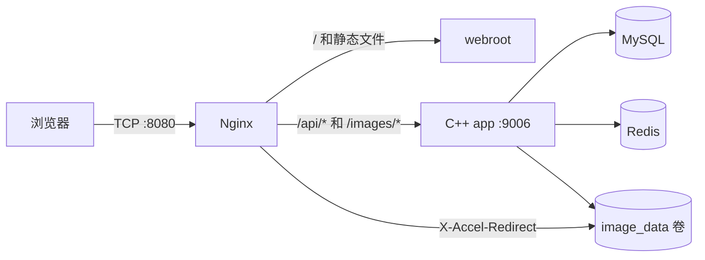
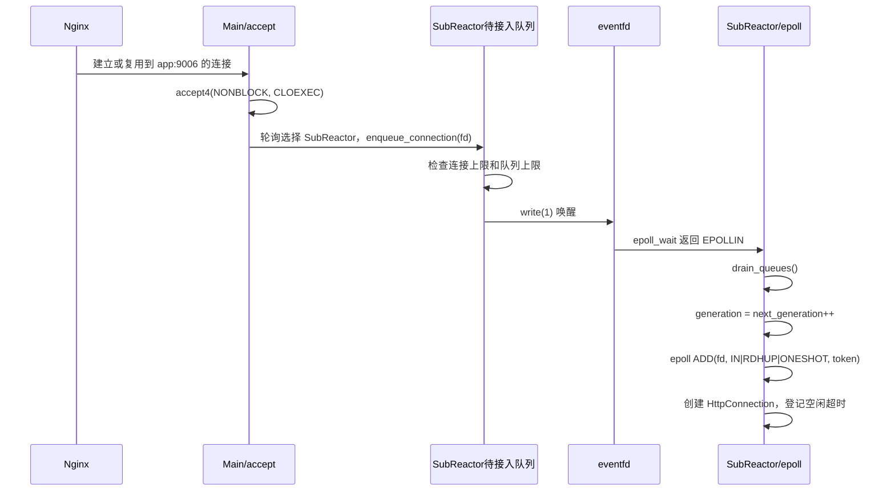
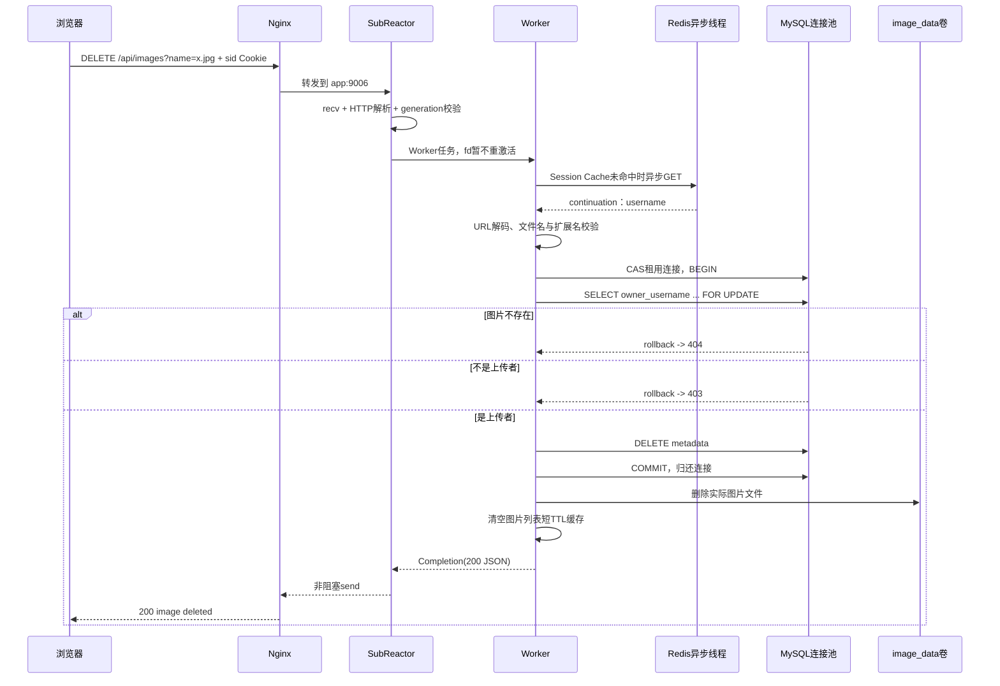

# MyWebServer 运行流程详解

本文按当前代码解释服务启动、连接建立、HTTP 请求处理、登录鉴权、图片上传/访问/删除、回写、超时和关闭流程。

## 1. 部署后的真实链路



首页 `/` 由 Nginx 直接读取 `webroot/index.html`，不会进入 C++。API 和受保护图片请求才会反向代理到 C++。Nginx 与 app 之间启用了 upstream keep-alive，因此一个浏览器连接不一定对应一次 app `accept`；Nginx 可以复用已有的后端连接。

## 2. 线程模型与所有权

一个 app 进程主要包含：

- 1 个主线程：初始化组件，之后阻塞在 `accept4`，只负责接收和分发连接。
- 2 个 SubReactor 线程：各自拥有一套 epoll、连接表、最小堆定时器、待接入队列和完成队列。
- 默认 6 个 Worker：解析后的业务任务、同步 MySQL 操作、文件元数据处理和响应构造。
- 1 个 Redis/libuv 线程：维护异步 Redis 连接池、命令队列、pipeline、回调与重连。
- 1 个日志线程：批量写 `server.log`。
- Nginx、MySQL、Redis 是另外的容器进程，不属于上述线程。

socket 的生命周期只允许所属 SubReactor 修改。Worker 不直接 `send`，只返回一个 `Completion`，再由 SubReactor 回写。这避免 Worker 和 Reactor 同时操作同一个 fd。

## 3. 启动流程

1. `main` 忽略 `SIGPIPE`，防止向已关闭连接发送数据导致进程退出。
2. 初始化异步日志，创建有界日志队列和日志线程。
3. 初始化 MySQL：读取环境变量、创建连接池、确保 `users/images` 表存在、为每条连接准备 Prepared Statements。
4. 初始化 Redis：创建 libuv loop 线程、异步连接池、命令队列和本地 Session Cache。
5. 创建 `WebServer`：10 MiB 文件 LRU、Worker 线程池、两个 SubReactor。
6. 创建监听 socket，执行 `bind/listen`。
7. 启动两个 SubReactor 线程。
8. 主线程进入永久 `accept4` 循环。

## 4. 一个后端 TCP 连接如何进入系统



连接按 `0,1,0,1...` 轮询分配给两个 SubReactor。待接入队列默认每个 1024，连接上限默认每个 4096。满时直接关闭 fd，并增加 `rejected_connections`。

`eventfd` 是跨线程通知器。主线程只入队并写 `eventfd`；真正的 epoll ADD 和连接表修改仍在 SubReactor 自己的线程完成。

### fd generation

每个 SubReactor 有独立的 `next_generation_`，每接管一个新连接就递增一次，不按 fd 分组。例如：

```text
fd=10 -> generation=1
fd=11 -> generation=2
fd=10 关闭后被系统复用 -> generation=3
```

epoll 的 64 位 `data.u64` 中，高 32 位存 generation，低 32 位存 fd。事件、定时器和 Worker 完成结果都携带 `(fd, generation)`。旧任务即使晚到，也不能误操作复用同编号 fd 的新连接。

## 5. 一个 API 请求如何被处理

1. epoll 返回 `EPOLLIN` 和 `(fd, generation)`。
2. SubReactor 先查连接表并比较 generation；不匹配的陈旧事件直接丢弃。
3. `HttpConnection::read_request` 循环 `recv`，直到 `EAGAIN`。
4. 先查找 `\r\n\r\n`，再读取 `Content-Length`，判断完整请求长度；最大请求为 8 MiB。
5. 请求不完整：刷新空闲定时器，执行 epoll MOD，重新激活 `EPOLLIN|EPOLLONESHOT`。
6. 请求完整：解析请求行、headers、body，并从连接读缓冲区移除这一条请求。多出来的 pipeline 数据仍留在缓冲区。
7. SubReactor 把定时器从“连接空闲超时”调整为“业务超时”，默认 15 秒。
8. 使用 `ThreadPool::try_submit` 投递 Worker。Worker 队列默认 4096；满时立即构造 503。
9. Worker 创建 `HttpResponse` 并进入路由/鉴权流程。
10. 响应完成后，不直接写 socket，而是进入所属 SubReactor 的完成队列并写 `eventfd`。
11. SubReactor 再次校验 `(fd, generation)`，然后调用 `flush_response`。
12. 如果 `send` 返回 `EAGAIN`，epoll MOD 为 `EPOLLOUT|EPOLLONESHOT`；可写后继续发送。
13. 发送完成后：非 keep-alive 关闭；keep-alive 则恢复空闲定时器，并直接检查读缓冲区中的下一条请求。

`EPOLLONESHOT` 使同一 fd 的一次事件被取走后暂时失活。业务处理期间不会再次把同一连接交给 Reactor，从而实现连接级串行化；代价是每次继续监听都要执行一次 `epoll_ctl MOD`。

## 6. Session 鉴权如何工作

需要 Session 的路径包括：

- `/api/me`
- `/api/images`
- `/api/upload-image`
- `/api/download`
- `/images/*`
- `DELETE /api/images`

处理流程：

1. 从 Cookie 中提取 `sid`，没有则直接 401。
2. 查询进程内短 TTL Session Cache，命中时得到 `username/display_name`。
3. 未命中时，把 `GET session:<token>` 放入有界 Redis 命令队列。
4. `uv_async_send` 唤醒 Redis/libuv 线程。
5. Redis 线程选择当前 outstanding 最少、pipeline 未满的连接。
6. hiredis 异步发送命令；libuv 收到回复后解析并更新本地缓存。
7. Redis 回调不直接执行后续业务，而是重新投递一个 Worker continuation。
8. Session 不存在返回 401；Redis 不可用返回 503；成功后进入鉴权路由。

Redis 连接不是某个 Worker 固定持有。所有业务线程共享异步 Redis 客户端；真正的 socket I/O 在专用 libuv 线程中完成。MySQL 则相反：它是同步连接池，Worker 在一次数据库操作期间动态租用一条连接。

## 7. 用户删除图片的完整流程



### 7.1 浏览器侧

前端 `deleteImage` 先弹确认框，然后调用：

```http
DELETE /api/images?name=<URL编码后的文件名>
Accept: application/json
Cookie: sid=<token>
```

请求成功后，前端再次执行 `GET /api/images` 刷新列表。

### 7.2 Nginx

`location /api/` 把请求转发给 `app:9006`，附加真实来源相关 headers，并清空上游 `Connection` header，以便复用后端连接。

### 7.3 Reactor 和 Worker

SubReactor 完成收包和 HTTP 解析后，用 ONESHOT 暂停该 fd，登记 15 秒业务超时并把任务投给 Worker。此时新到达的数据只会停留在内核/连接读缓冲区，不会并发处理同一连接。

### 7.4 Session

路由判断 DELETE 图片必须登录。`sid` 不存在或过期返回 401；Redis 异常返回 503。Session 成功后，得到可信的 `session.username`。权限判断使用 Session 中的 username，而不是客户端提交的 username。

### 7.5 输入校验

代码提取 query 参数 `name`，URL 解码后经过 `safe_filename`。必须满足：

- 非空；
- 清洗后的名字和原始名字完全相同，防止目录穿越或非法字符；
- 最长 255；
- 扩展名属于 png/jpg/jpeg/webp/gif。

失败返回 400，不依赖数据库兜底。

### 7.6 MySQL 权限检查和删除

Worker 动态租用 MySQL 连接：

- 先从轮询起点扫描健康空闲连接；
- 通过 `in_use.compare_exchange_strong(false -> true)` 独占；
- 都忙时最多等待 `MYSQL_POOL_WAIT_TIMEOUT_MS`，默认 100 ms；
- 没拿到返回 503；
- 连接断开时标记 unhealthy 并尝试重建连接和 Prepared Statements。

删除使用事务：

```sql
SELECT owner_username
FROM images
WHERE stored_name = ?
LIMIT 1
FOR UPDATE;
```

`FOR UPDATE` 锁定该元数据行，避免两个并发删除同时通过检查。找不到返回 404；owner 与 Session username 不一致返回 403。相同时执行：

```sql
DELETE FROM images
WHERE owner_username = ? AND stored_name = ?;
```

影响行数为 0 返回 404，否则提交事务并归还连接。

### 7.7 文件和缓存

数据库提交后，Worker 删除 `web_root/images/<stored_name>`。Docker 中这个路径对应共享的 `mywebserver_image_data` 卷。之后清空进程内图片列表缓存并返回 200。

当前数据库与文件系统不在同一事务：如果数据库已经提交，但文件删除失败，接口返回 500，数据库元数据已经消失而文件可能残留。这是当前删除链路最重要的一致性边界。

## 8. 图片上传流程

1. Session 鉴权。
2. `UploadPermit` 按 username 限制同时上传数，默认 2；超出返回 429。
3. 解析 multipart；HTTP 总请求最大 8 MiB，图片内容最大 6 MiB。
4. 校验安全文件名、扩展名和 PNG/JPEG/GIF/WebP 文件魔数。
5. 计算图片内容 SHA-256。
6. 服务器名为“username 哈希前 12 位 + 内容哈希 + 扩展名”。
7. MySQL 事务锁定用户行，统计该用户图片数，默认上限 100。
8. `(owner_username, content_hash)` 唯一索引阻止同一用户重复上传同内容；重复返回 409。
9. 先插入元数据并提交，再把文件写入 `.uploading` 临时文件，最后原子 rename 发布。
10. 写文件失败时尝试删除刚插入的元数据；成功后清空图片列表缓存。

上传也跨越 MySQL 与文件系统，因此代码使用补偿删除，而不是一个真正的跨资源事务。

## 9. 图片查看和下载

1. `/images/<name>` 和 `/api/download?name=` 都先验证 Session。
2. C++ 校验文件名和文件是否存在。
3. 开启 `X_ACCEL_REDIRECT=1` 时，C++ 不复制图片内容，只返回：

```http
X-Accel-Redirect: /protected-images/<name>
```

4. Nginx 的 `/protected-images/` 被标记为 `internal`，客户端不能直接访问。
5. Nginx 从只读挂载的图片卷发送文件，并承担慢客户端回压。

这里的权限是“登录用户可查看全部图片，只有上传者可删除”。目前图片列表来自文件目录且不包含 owner，前端会给每张图片都画删除按钮；非上传者点击后由后端返回 403。

## 10. 首页、静态文件和 LRU

Docker/Nginx 部署时：首页由 Nginx 直接发送，C++ 的文件 LRU 不参与首页压测。

直接访问 C++ 静态路径时：

- 小于等于 256 KiB 的文件进入 10 MiB、8 分片的 LRU；
- 读取使用 shared lock；每 16 次访问才提升一次 LRU 位置，减少写锁竞争；
- 大文件不进内存缓存，C++ fallback 路径通过 `sendfile` 发送；
- 正常生产图片链路使用 Nginx/X-Accel，因此 C++ sendfile 主要是关闭 X-Accel 时的备用路径。

## 11. 超时、取消、关闭与回写

每个 SubReactor 有自己的最小堆定时器：

- 等待下一段请求：连接空闲超时，默认 60 秒；
- Worker/Redis/MySQL 处理期间：业务超时，默认 15 秒。

超时回调在 SubReactor 线程关闭连接：删除定时器、设置 cancellation token、epoll DEL、close fd、删除连接对象。

取消令牌能让排队任务、Redis回调和数据库操作在检查点提前退出，但不能强行中断正在进行的同步 `mysql_stmt_execute` 或内核调用。因此“连接已超时关闭”不严格等于“业务代码已经停止”；完成结果回来后还会经过 generation/cancelled 检查而被丢弃。

完成队列默认 4096。队列满时 Worker 会等待空位，形成回压。Worker 队列满时不等待，直接返回 503；日志队列满时丢日志并增加指标；Redis命令队列满时返回错误并增加指标。

## 12. 当前实现需要理解的边界

1. 首页压测主要测 Nginx 静态文件，不代表 C++ API QPS。
2. HTTP 解析器只完整支持 `Content-Length` 模式，没有实现 chunked request、完整 RFC 校验等生产级能力。
3. 图片列表扫描文件目录而不是查询数据库，所以返回结果没有 owner，前端无法提前隐藏无权限的删除按钮。
4. 任意已登录用户可以查看/下载全部图片；删除才做 owner 校验。
5. 删除先提交数据库再删文件，存在孤儿文件窗口；上传也依赖补偿事务。
6. MySQL 是同步池，池等待和数据库 I/O 会占用 Worker；Redis I/O 是异步的。
7. 主线程使用单 accept 循环；大量短连接时可能成为瓶颈，Nginx upstream keep-alive 能显著降低该压力。
8. generation 实际打包为 32 位，约 42 亿次接管后才理论回绕。

## 13. 最应该掌握的代码入口

- `src/main.cpp`：所有组件启动顺序。
- `src/server/WebServer.cpp`：监听、accept、轮询分发。
- `src/server/SubReactor.cpp`：epoll、eventfd、ONESHOT、定时器、Worker 与回写。
- `src/http/HttpConnection.cpp`：非阻塞收发、请求边界、sendfile。
- `src/http/HttpResponse.cpp`：路由、Session、图片业务、缓存和 HTTP 响应。
- `src/db/UserStore.cpp`：MySQL 连接池、Prepared Statements、事务和权限校验。
- `src/auth/AsyncSessionManager.cpp`：异步 Redis、libuv、pipeline、Session Cache。
- `include/threadpool/ThreadPool.h`：有界 Worker 队列。
- `src/timer/HeapTimer.cpp`：每个 SubReactor 的超时管理。
- `src/log/AsyncLogger.cpp`：独立日志线程和有界日志队列。
